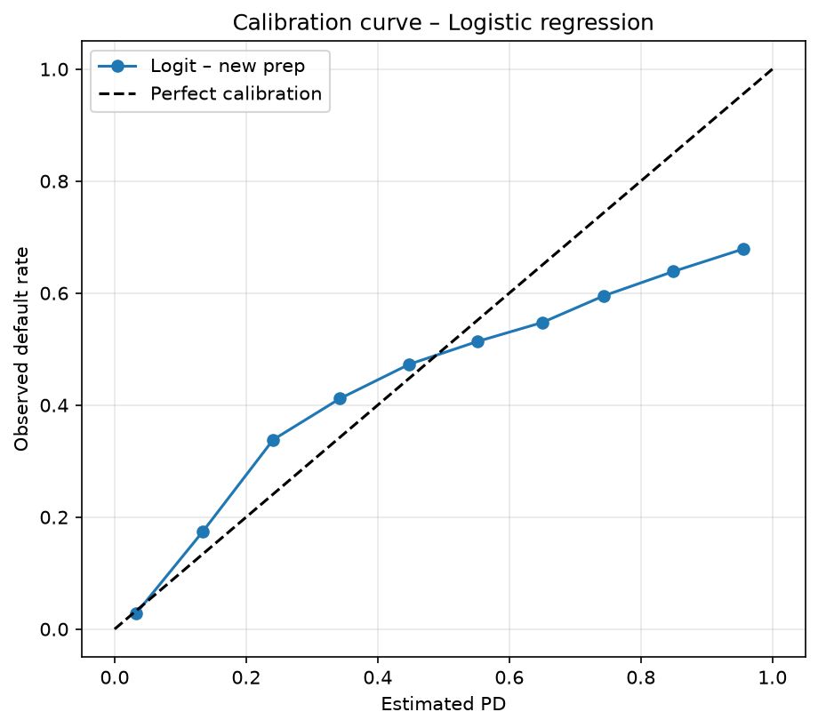
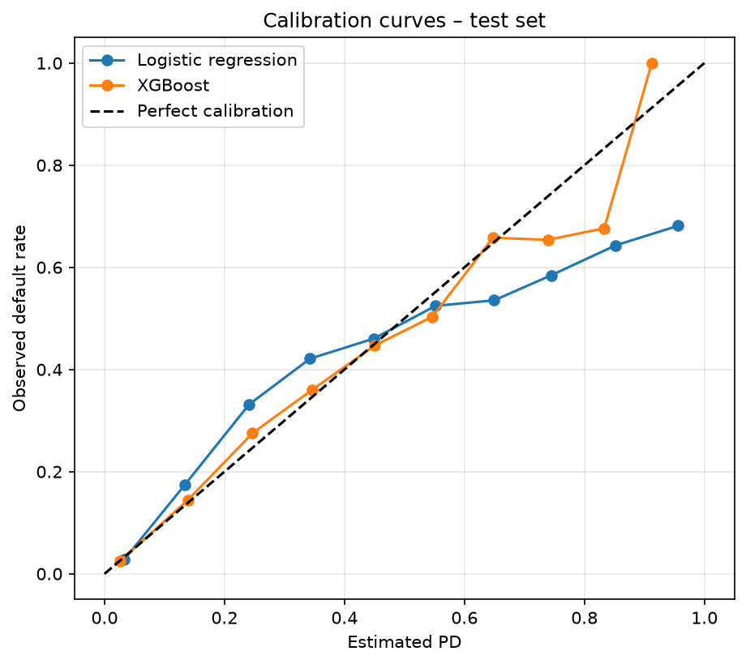
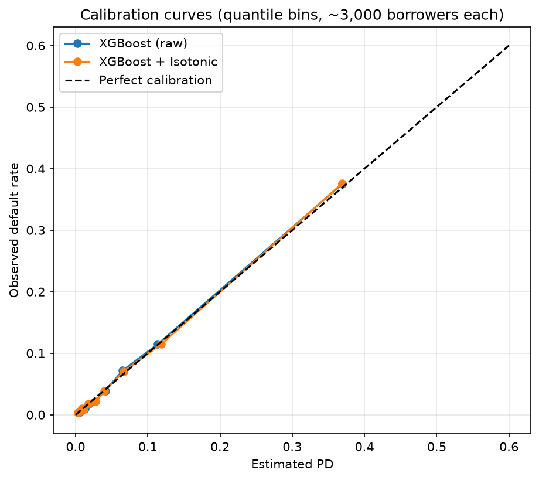
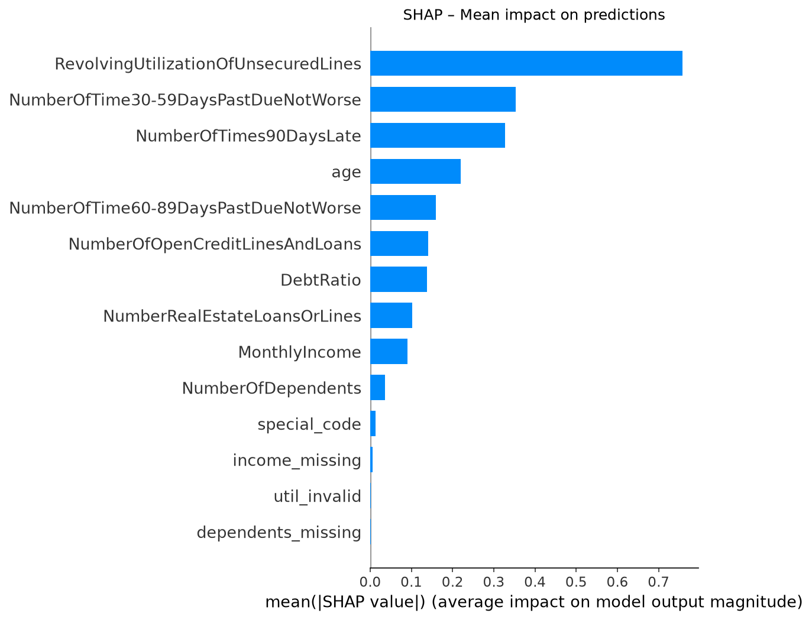
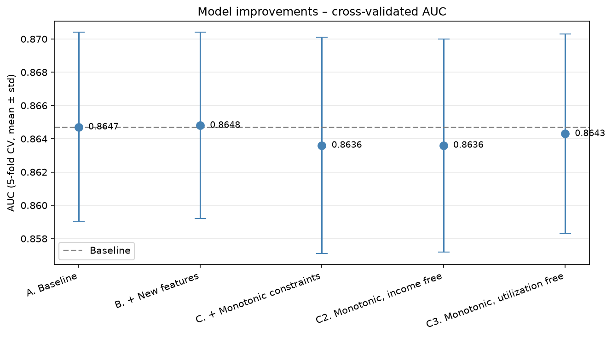

# Credit Risk – Probability of Default Modeling

> 🚧 **Work in progress.** This repository is being built step by step; results are added as each stage is validated.

## Objective

Estimate the **probability of default (PD)** of borrowers and compare an interpretable baseline (logistic regression) with more flexible machine learning models (Random Forest, Gradient Boosting).

The goal is not only to rank borrowers by risk, but to produce **calibrated, explainable PDs** that could support credit decisions, provisioning and stress testing.

This project extends my undergraduate thesis in Actuarial Science (University of Buenos Aires).

## Key finding so far: SMOTE breaks PD calibration

In my thesis, all models were trained on a SMOTE-balanced dataset and every calibration curve sat below the diagonal. To test whether SMOTE was the cause, I ran a controlled experiment: same data, same split, same logistic regression, with and without SMOTE.

| Model | AUC | Brier score | Average PD |
|---|---|---|---|
| Logistic regression **with** SMOTE | 0.812 | 0.155 | 36.9% |
| Logistic regression **without** SMOTE | 0.807 | 0.052 | 6.5% |
| Naive benchmark (everyone gets the observed default rate) | 0.500 | 0.062 | 6.6% |

*Observed default rate in the test set: 6.6%.*

- **Ranking is unchanged:** AUC is almost identical with or without SMOTE.
- **Probabilities are not:** SMOTE inflates the average PD more than 5×, and its Brier score is worse than the naive benchmark.
- **Why:** SMOTE moves the training default rate from 6.6% to 50%, which shifts every predicted log-odds upward. The order of borrowers is preserved; the level of their PDs is not.
- **Why it matters:** an overestimated PD inflates IFRS 9 provisions and Basel capital, and prices good borrowers out of credit.

👉 Full experiment: [`notebooks/smote_calibration_experiment.ipynb`](notebooks/smote_calibration_experiment.ipynb)

## Update: better data beats a more complex model

Treating the anomalies found in the EDA (special codes, invalid utilization records, informative missing values) and fitting every statistic on the training set only:

| Model | AUC | Brier score | Average PD |
|---|---|---|---|
| Logistic regression – thesis preprocessing | 0.807 | 0.052 | 6.5% |
| **Logistic regression – new preprocessing** | **0.859** | **0.051** | **6.7%** |
| XGBoost – original thesis (with SMOTE) | 0.832 | 0.066 | – |

A simple, interpretable logistic regression with well-treated data outperforms the best model of the original thesis. The gain holds when the riskiest borrowers (codes 96/98) are excluded from the test set (AUC 0.858).



👉 [`notebooks/03_Logistic_Regression.ipynb`](notebooks/03_Logistic_Regression.ipynb)

## Model comparison: XGBoost vs. logistic regression

Compared with 5-fold stratified cross-validation on the training set, then evaluated once on the test set.

| Model | CV AUC (mean ± std) | Test AUC | Brier score | Average PD |
|---|---|---|---|---|
| Logistic regression | 0.852 ± 0.007 | 0.859 | 0.0507 | 6.7% |
| **XGBoost** | **0.865 ± 0.006** | **0.870** | **0.0487** | **6.7%** |
| XGBoost – original thesis (with SMOTE) | – | 0.832 | 0.0657 | – |

- XGBoost outperforms on both discrimination and calibration, and the gap is stable across folds.
- With the new preprocessing and no SMOTE, the same algorithm improves from 0.832 to 0.870 AUC and cuts the Brier score by 26%.
- XGBoost corrects the S-shaped miscalibration of the logistic regression in the 10–45% PD range.



👉 [`notebooks/04_Model_Comparison.ipynb`](notebooks/04_Model_Comparison.ipynb)

## Calibration, interpretability and final model

**Post-hoc calibration is not needed.** Without SMOTE, XGBoost is already well calibrated: Platt scaling worsens the Brier score (0.0487 → 0.0504) and isotonic regression leaves it unchanged. With quantile bins (~3,000 borrowers each), the calibration curve lies on the diagonal, including the riskiest decile (estimated PD ~37%, observed ~37.5%).



**Both models agree on the drivers of risk.** The top 5 drivers are identical in XGBoost (SHAP) and the logistic regression: revolving utilization, the three past-due variables and age. XGBoost also recovers the economically correct sign of `DebtRatio`, which the linear model could not.



**Final model: XGBoost with monotonic constraints.** Feature engineering added nothing (trees already build those combinations). Monotonic constraints cost almost nothing once utilization is left free, as the EDA showed it is not monotonic at the low end. The final model matches the baseline on the test set (AUC 0.870, Brier 0.0487) while guaranteeing economically coherent behavior.



👉 [`notebooks/05_Calibration_Interpretability.ipynb`](notebooks/05_Calibration_Interpretability.ipynb) · [`notebooks/05b_Model_Improvements.ipynb`](notebooks/05b_Model_Improvements.ipynb)

## Questions this project answers

1. How much predictive power do ML models add over logistic regression?
2. Are the estimated probabilities well calibrated, so they can be read as PDs?
3. Which drivers explain default risk, and do the models agree on them?
4. How does the portfolio's PD change under adverse scenarios?

## Methodology

| Stage | Notebook | Status |
|---|---|---|
| SMOTE and calibration experiment | `smote_calibration_experiment.ipynb` | ✅ |
| Exploratory data analysis | `01_EDA.ipynb` | ✅ |
| Data preparation & feature engineering | `02_Data_Preparation.ipynb` | ✅ |
| Logistic regression baseline | `03_Logistic_Regression.ipynb` | ✅ |
| Model comparison (Random Forest, Gradient Boosting) | `04_Model_Comparison.ipynb` | ✅ |
| Calibration & interpretability (Brier score, SHAP) | `05_Calibration_Interpretability.ipynb` | ✅ |
| Model improvements (feature engineering, monotonic constraints) | `05b_Model_Improvements.ipynb` | ✅ |
| Portfolio stress testing | `06_Stress_Testing.ipynb` | ⬜ |

**Evaluation:** ROC-AUC, Gini, KS, precision/recall, calibration curves and Brier score, always compared against a naive benchmark.

## Data

[Give Me Some Credit](https://www.kaggle.com/c/GiveMeSomeCredit) (Kaggle): 150,000 borrowers, 10 features, target = serious delinquency (90+ days past due) within 2 years.

The data is not included in this repository (Kaggle's terms do not allow redistribution). To reproduce: download `cs-training.csv` and place it in `data/raw/`.

## Repository structure

```
credit-risk-pd-modeling/
├── data/
│   ├── raw/                  # original Kaggle data (not tracked)
│   └── processed/            # train/test sets generated by notebook 02 (not tracked)
├── notebooks/
│   ├── smote_calibration_experiment.ipynb
│   ├── 01_EDA.ipynb
│   ├── 02_Data_Preparation.ipynb
│   └── 03_Logistic_Regression.ipynb
│   └── 04_Model_Comparison.ipynb
│   ├── 05_Calibration_Interpretability.ipynb
│   └── 05b_Model_Improvements.ipynb
├── src/                      # reusable functions
├── reports/
│   └── figures/              # charts used in this README
├── requirements.txt
└── README.md
```

## Next steps

1. Post-hoc calibration (Platt / isotonic) and SHAP interpretability.
2. Review the negative `DebtRatio` coefficient (residual extreme values from near-zero incomes).
3. Portfolio stress testing of aggregate PD.

## Author

**Ramiro López** · Actuarial Science, University of Buenos Aires · ramalopez1510@gmail.com
