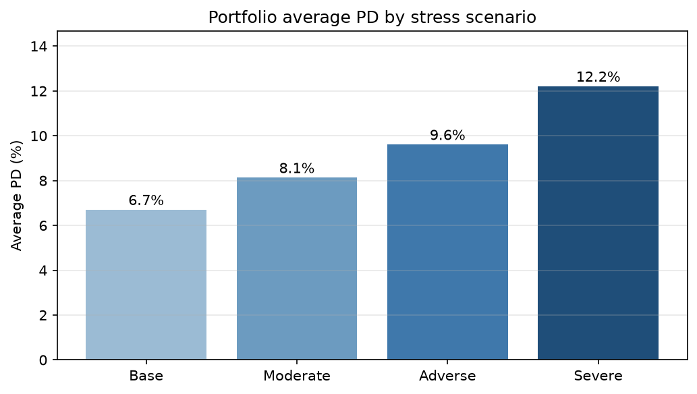
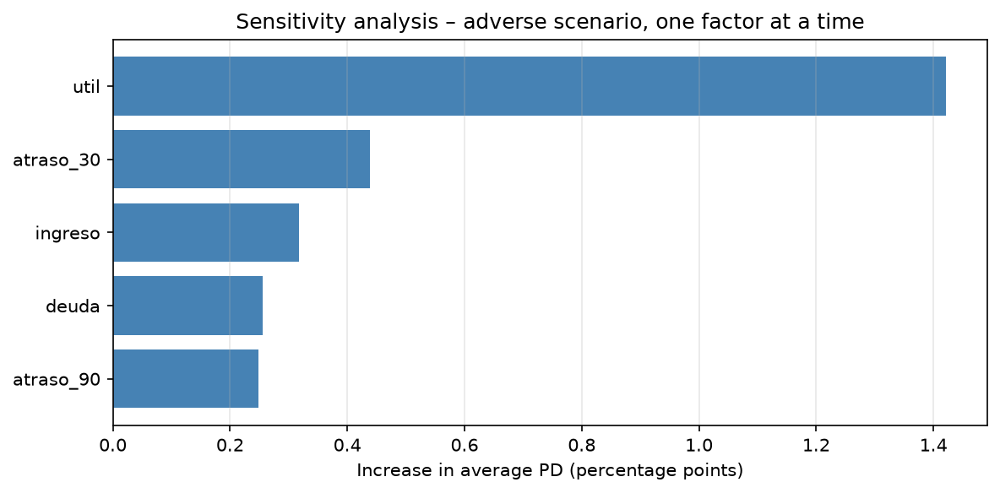

# Credit Risk – Probability of Default Modeling

End-to-end PD modeling project: data quality analysis, leakage-free preparation, model comparison, calibration, interpretability and portfolio stress testing. It extends my undergraduate thesis in Actuarial Science (University of Buenos Aires).

## Key results

| | Result |
|---|---|
| **Calibration fix** | Removing SMOTE brought the average PD from 36.9% back to the observed 6.7% and cut the Brier score by 3× |
| **Data quality** | Found a group coded 96/98 with a 54.7% default rate (8× the portfolio) that the original preprocessing dropped |
| **Better data > complex model** | A logistic regression on the new preprocessing (AUC 0.859) beats the thesis' XGBoost (0.832) |
| **Final model** | XGBoost with monotonic constraints: AUC 0.870, Brier 0.0487, well calibrated without post-hoc correction |
| **Stress testing** | Under a severe scenario the portfolio's average PD rises from 6.7% to 12.2% (+82%), driven mainly by credit utilization |

## 1. SMOTE breaks PD calibration

In my thesis, all models were trained on a SMOTE-balanced dataset and every calibration curve sat below the diagonal. A controlled experiment (same data, split and model, with and without SMOTE):

| Model | AUC | Brier score | Average PD |
|---|---|---|---|
| Logistic regression **with** SMOTE | 0.812 | 0.155 | 36.9% |
| Logistic regression **without** SMOTE | 0.807 | 0.052 | 6.5% |
| Naive benchmark (everyone gets the observed default rate) | 0.500 | 0.062 | 6.6% |

SMOTE moves the training default rate from 6.6% to 50%. The ranking of borrowers is preserved (same AUC), but every PD is inflated. An overestimated PD inflates IFRS 9 provisions and Basel capital, and prices good borrowers out of credit.

👉 [`notebooks/smote_calibration_experiment.ipynb`](notebooks/smote_calibration_experiment.ipynb)

## 2. Better data beats a more complex model

The EDA found special codes (96/98) in past-due variables, invalid utilization records (> 10) and informative missing values. The new preparation keeps the riskiest borrowers, flags each anomaly and fits every statistic on the training set only.

| Model | AUC | Brier score | Average PD |
|---|---|---|---|
| Logistic regression – thesis preprocessing | 0.807 | 0.052 | 6.5% |
| **Logistic regression – new preprocessing** | **0.859** | **0.051** | **6.7%** |
| XGBoost – original thesis (with SMOTE) | 0.832 | 0.066 | – |

The gain holds when the 96/98 borrowers are excluded from the test set (AUC 0.858). Revolving utilization goes from a near-zero coefficient to the strongest driver once its outliers are treated.

👉 [`notebooks/01_EDA.ipynb`](notebooks/01_EDA.ipynb) · [`notebooks/02_Data_Preparation.ipynb`](notebooks/02_Data_Preparation.ipynb) · [`notebooks/03_Logistic_Regression.ipynb`](notebooks/03_Logistic_Regression.ipynb)

## 3. Model comparison

5-fold stratified cross-validation on the training set, then a single evaluation on the test set.

| Model | CV AUC (mean ± std) | Test AUC | Brier score | Average PD |
|---|---|---|---|---|
| Logistic regression | 0.852 ± 0.007 | 0.859 | 0.0507 | 6.7% |
| **XGBoost** | **0.865 ± 0.006** | **0.870** | **0.0487** | **6.7%** |

XGBoost captures non-linear effects (the jump in risk above 70% utilization, the U-shape of open credit lines) and corrects the S-shaped miscalibration of the logistic regression.


👉 [`notebooks/04_Model_Comparison.ipynb`](notebooks/04_Model_Comparison.ipynb)

## 4. Calibration, interpretability and final model

- **No post-hoc calibration needed:** Platt scaling worsens the Brier score and isotonic regression leaves it unchanged. With quantile bins (~3,000 borrowers each) the curve lies on the diagonal, including the riskiest decile (estimated PD ~37%, observed ~37.5%).
- **Both models agree on the drivers:** the top 5 are identical in XGBoost (SHAP) and the logistic regression: utilization, the three past-due variables and age.
- **Final model: XGBoost with monotonic constraints.** Feature engineering added nothing; monotonic constraints cost almost nothing once utilization is left free (the EDA showed it is not monotonic at the low end). Same test performance as the baseline (AUC 0.870), with economically coherent behavior.


👉 [`notebooks/05_Calibration_Interpretability.ipynb`](notebooks/05_Calibration_Interpretability.ipynb) · [`notebooks/05b_Model_Improvements.ipynb`](notebooks/05b_Model_Improvements.ipynb)

## 5. Portfolio stress testing

Borrower characteristics of the test portfolio (30,000 borrowers) are shocked under hypothetical scenarios (higher utilization, lower income, higher debt, new delinquencies), and PDs are recomputed with the final model.

| Scenario | Average PD | Expected defaults | Borrowers with PD > 20% | Change vs. base |
|---|---|---|---|---|
| Base | 6.71% | 2,013 | 8.67% | – |
| Moderate | 8.13% | 2,440 | 10.88% | +21% |
| Adverse | 9.61% | 2,884 | 13.34% | +43% |
| **Severe** | **12.21%** | **3,664** | **18.59%** | **+82%** |

- Revolving utilization explains 1.42 pp of the 2.90 pp increase in the adverse scenario: it is the key early-warning indicator.
- Factors interact: the combined scenario (2.90 pp) exceeds the sum of individual shocks (2.69 pp).
- **Limitations:** shocks are assumptions (no macro variables in the dataset), relationships are assumed stable under stress, and there are no second-round effects or exposure data.





👉 [`notebooks/06_Stress_Testing.ipynb`](notebooks/06_Stress_Testing.ipynb)

## Methodology

| Stage | Notebook | Status |
|---|---|---|
| SMOTE and calibration experiment | `smote_calibration_experiment.ipynb` | ✅ |
| Exploratory data analysis | `01_EDA.ipynb` | ✅ |
| Data preparation | `02_Data_Preparation.ipynb` | ✅ |
| Logistic regression baseline | `03_Logistic_Regression.ipynb` | ✅ |
| Model comparison with cross-validation | `04_Model_Comparison.ipynb` | ✅ |
| Calibration and interpretability (SHAP) | `05_Calibration_Interpretability.ipynb` | ✅ |
| Feature engineering and monotonic constraints | `05b_Model_Improvements.ipynb` | ✅ |
| Portfolio stress testing | `06_Stress_Testing.ipynb` | ✅ |

**Evaluation:** AUC, Gini, KS (discrimination), Brier score and calibration curves (calibration), always compared against a naive benchmark.

## Data

[Give Me Some Credit](https://www.kaggle.com/c/GiveMeSomeCredit) (Kaggle): 150,000 borrowers, 10 features, target = serious delinquency (90+ days past due) within 2 years.

The data is not included in this repository (Kaggle's terms do not allow redistribution). To reproduce: download `cs-training.csv`, place it in `data/raw/` and run the notebooks in order.

## Repository structure

```
credit-risk-pd-modeling/
├── data/
│   ├── raw/                  # original Kaggle data (not tracked)
│   └── processed/            # train/test sets generated by notebook 02 (not tracked)
├── notebooks/
│   ├── smote_calibration_experiment.ipynb
│   ├── 01_EDA.ipynb
│   ├── 02_Data_Preparation.ipynb
│   ├── 03_Logistic_Regression.ipynb
│   ├── 04_Model_Comparison.ipynb
│   ├── 05_Calibration_Interpretability.ipynb
│   ├── 05b_Model_Improvements.ipynb
│   └── 06_Stress_Testing.ipynb
├── src/                      # reusable functions
├── reports/
│   └── figures/              # charts used in this README
├── requirements.txt
└── README.md
```

## Next steps

- Move reusable code (evaluation metrics, feature engineering, stress scenarios) to `src/`.

## Author

**Ramiro López** · Actuarial Science, University of Buenos Aires · ramalopez1510@gmail.com
